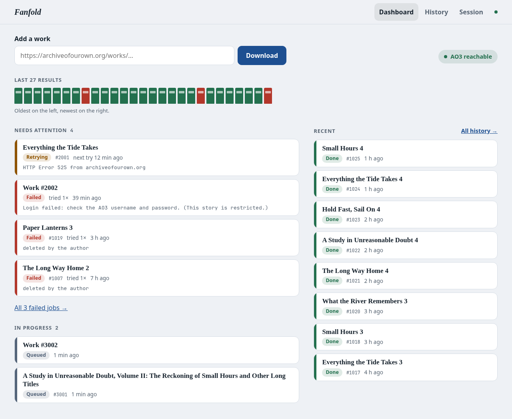
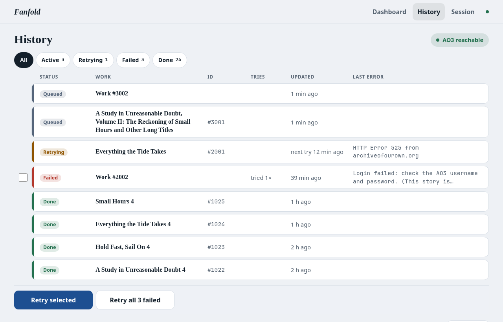
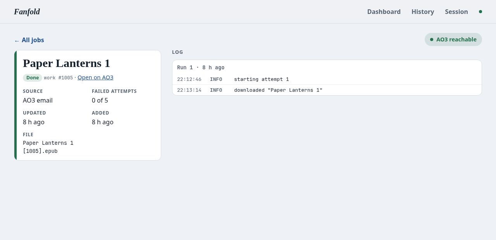
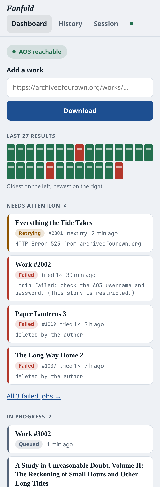
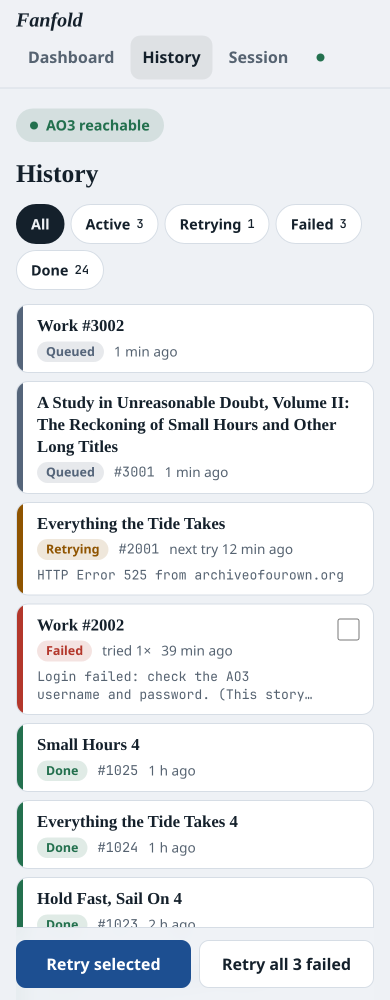
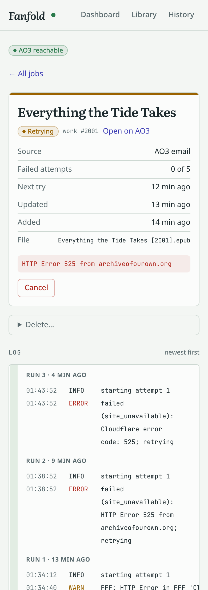
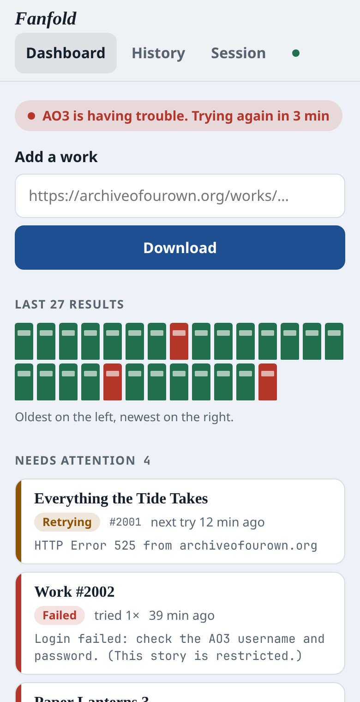

# Fanfold

Fanfold keeps an e-reader library of [AO3](https://archiveofourown.org) works up to date.
It downloads works as EPUB files into a folder you sync to your reader (with Syncthing, for
example), and downloads them again when new chapters appear. You queue works or whole series
by pasting a link, or automatically from AO3's subscription emails.

- One small service plus a PostgreSQL database. A web page shows what is queued, running,
  finished or failed, and lets you retry.
- Books are filed by series or by author (see [the library](#the-library-and-its-history)) and
  keep their path forever, so your reader keeps your place when a work is updated.
- Everything AO3 says about a work is kept as a timeline: which update added a tag, when a work
  became restricted, how chapters and words grew.
- If AO3 has a bad day, Fanfold backs off and retries by itself instead of failing everything.
- Optional notifications to Discord.

Downloading is done by [FanFicFare](https://github.com/JimmXinu/FanFicFare); Fanfold schedules
the work, keeps the library tidy and gives you the interface. It was inspired by
[AutomatedFanfic](https://github.com/MrTyton/AutomatedFanfic).

## Contents

[Quick start](#quick-start) · [Configuration](#configuration) · [Adding works](#adding-works) ·
[The library and its history](#the-library-and-its-history) ·
[Getting past Cloudflare](#getting-past-cloudflare) · [The web interface](#the-web-interface) ·
[The container image](#the-container-image) · [Running without Docker](#running-without-docker) ·
[Operating it](#operating-it) · [Troubleshooting](#troubleshooting) · [Development](#development)

## Quick start

You need Docker (or Podman) and a PostgreSQL database.

**1. Create the database.** Fanfold creates its own tables on first start.

```sql
CREATE USER fanfold PASSWORD 'choose-a-password';
CREATE DATABASE fanfold OWNER fanfold;
```

**2. Write `config.toml`.** Secrets are never written in the file; you point at an environment
variable or a file that holds them.

```toml
[database]
host = "postgres"                   # your PostgreSQL host
name = "fanfold"
user = "fanfold"
password = { env = "DB_PASSWORD" }
ssl_mode = "prefer"                 # disable | prefer | require | verify-ca | verify-full

[library]
path = "/library"                   # where the EPUBs go

[downloader]
python = "/opt/venv/bin/python"     # already in the image

[ao3]                               # your AO3 login (see "Getting past Cloudflare")
username = { env = "AO3_USERNAME" }
password = { env = "AO3_PASSWORD" }
```

**3. Start it.** Replace the paths and secrets. The flags make the container read-only and
unprivileged (see [The container image](#the-container-image)); they are optional.

```sh
docker run -d --name fanfold --restart unless-stopped \
  --read-only --cap-drop ALL --security-opt no-new-privileges \
  --tmpfs /tmp/fanfold:rw,nosuid,nodev,noexec,mode=0770,uid=10001,gid=10001 \
  --tmpfs /run/fanfold:rw,nosuid,nodev,noexec,mode=0700,uid=10001,gid=10001 \
  -v /srv/fanfold/library:/library \
  -v "$PWD/config.toml":/etc/fanfold/config.toml:ro \
  -e DB_PASSWORD -e AO3_USERNAME -e AO3_PASSWORD \
  -p 8080:8080 \
  ghcr.io/arlllk/fanfold:latest
```

Check the configuration first if you like; it validates the file and that every secret
resolves, without touching the network or the database:

```sh
docker run --rm -v "$PWD/config.toml":/etc/fanfold/config.toml:ro \
  -e DB_PASSWORD -e AO3_USERNAME -e AO3_PASSWORD ghcr.io/arlllk/fanfold:latest check-config
```

**4. Add a work.** Open <http://localhost:8080>, paste a link such as
`https://archiveofourown.org/works/123`, and press **Download**. The EPUB appears in
`/srv/fanfold/library` and the page shows the result. Point your reader's sync at that folder.

> The web interface has no login of its own. Put it behind your reverse proxy or
> authentication gateway before exposing it beyond your own machine.

## Configuration

One TOML file, `/etc/fanfold/config.toml` in the image (override with `--config PATH` or
`FANFOLD_CONFIG`). A complete, commented example is in
[`config/config.example.toml`](config/config.example.toml). Fanfold refuses to start, and
lists every problem at once, if something is wrong. Changing the file requires a restart.

**Secrets** are references, never values. A plain string where a secret belongs is rejected.

```toml
password = { env = "NAME" }            # an environment variable
password = { file = "/run/secrets/x" } # a file (a trailing newline is ignored)
```

**Durations** are a whole number plus a unit: `"500ms"`, `"30s"`, `"5m"`, `"2h"`, `"1d"`.

| Section | Setting (default) | What it does |
|---|---|---|
| `[database]` | `host`, `port` (5432), `name`, `user`, `password`, `ssl_mode` (`require`), `max_connections` (5) | PostgreSQL connection. Use a session-level connection: a pooler in transaction mode breaks live updates. |
| `[library]` | `path`, `scratch` (`/tmp/fanfold`) | `path` is the folder of finished books; `scratch` is temporary per-download space. |
| `[ao3]` | `username`, `password` | Your AO3 login. Required unless you use FlareSolverr; with FlareSolverr it is optional and only used for works that need a login. |
| `[downloader]` | `python`, `timeout` (`10m`), `personal_ini` | The Python with FanFicFare installed, the longest one download may take, and where the generated FanFicFare settings are written. |
| `[downloader.flaresolverr]` | `url`, `timeout` (`60s`) | Optional. Fetch through FlareSolverr. See [Getting past Cloudflare](#getting-past-cloudflare). |
| `[retry]` | `max_attempts` (5), `base` (`1m`), `cap` (`1h`) | A failing job is retried with a doubling delay. Only failures that are the work's own fault use up attempts; AO3 being down does not. |
| `[breaker]` | `failure_threshold` (3), `open_for` (`2m`), `max_open_for` (`1h`) | After this many site-wide failures in a row, Fanfold pauses downloads and probes now and then. |
| `[worker]` | `poll_interval` (`5s`), `concurrency` (1) | Keep concurrency at 1: AO3 rate-limits. |
| `[web]` | `listen` (`0.0.0.0:8080`), `ops_listen` (`0.0.0.0:9090`), `page_size` (20) | The interface, and the health and metrics port. |
| `[mail]` | see [Adding works](#adding-works) | Optional. Queue works from AO3 emails. |
| `[discord]` | `webhook` | Optional. Post downloads and failures to a Discord channel. |

Logs go to standard output. `RUST_LOG=debug` raises the detail and `FANFOLD_LOG_FORMAT=json`
switches to JSON lines.

## Adding works

**By hand.** Paste a link into the web page, or run

```sh
docker exec fanfold fanfold enqueue https://archiveofourown.org/works/123
```

A work that is already queued or running is not queued twice. Links with `?view_adult=true`
or a chapter path are understood.

**A whole series.** Paste a series link (`https://archiveofourown.org/series/123`). Fanfold
lists the series, follows it, and queues every work in it; each is filed under the series'
folder. Pressing **List the series again** on its job later queues any works added since.

**From AO3's subscription emails.** Subscribe to the works or authors you follow on AO3 and
forward the notifications to a mailbox on a JMAP server (tested with
[Stalwart](https://stalw.art); any JMAP server should do). Then add:

```toml
[mail]
jmap_url = "https://mail.example.org"       # where the server publishes its JMAP session
username = "fanfold@example.org"
password = { env = "MAIL_PASSWORD" }
allowed_senders = ["archiveofourown.org"]   # only mail from these senders is used
poll_interval = "60s"                       # new mail also wakes it immediately (push)
backfill = "7d"                             # first start only: how far back to read
```

- Each notification becomes a download of the work it mentions. A burst of chapter
  notifications for the same work, even weeks of them, collapses into one download.
- A series link in a notification (AO3's series subscriptions send one) makes Fanfold follow
  that series: new works in it are filed under its folder. Only the works the email links are
  downloaded; the rest of the series is not fetched again.
- Fanfold reads the mailbox and changes nothing in it, and it remembers where it stopped, so
  a restart never re-downloads old mail.
- The sender match ignores punctuation, so relay-rewritten senders such as
  `do-not-reply_at_archiveofourown_org_x` still match.
- JMAP servers tell clients where their API lives. That address must be reachable from where
  Fanfold runs (the server's public name must resolve to it, with a valid certificate).
- If another tool reads the same mailbox, both will download; point one at a different mailbox.

## The library and its history

**Layout.** A work in a series you follow (added by link, or seen in a series email) goes under
the series; any other work under its author line:

```
series/The Harbor Saga 2000001/01 The Lighthouse Keeper 10000002.epub
series/The Harbor Saga 2000001/02 The Keeper and the Logbook 10000004.epub
single/paperboats/The Tidewater Letters 10000003.epub
```

- The part number is AO3's at the first download. A book's path, and a series' folder name,
  are chosen once and never change afterwards, even if the work is renamed, the series
  reordered, or the series followed later: e-readers key reading progress on the path.
- A work in several followed series goes under the first one AO3 lists on the work's page.

**History.** Every download records what AO3 said about the work, in PostgreSQL. A new
*version* is written only when something changed (title, summary, rating, status, restricted,
dates, chapter and word counts, authors, tags, series, chapters); hits, kudos, comments and
bookmarks are recorded on every visit without counting as a change. Each tag, author, series
membership and chapter is a span from the version that added it to the one that removed it.
FanFicFare's full answer is kept with each version (`raw`, JSON) for anything not parsed.

| Table or view | Holds |
|---|---|
| `work_timeline` (view) | every version of every work, with readable times |
| `work_tag_timeline` (view) | when each tag was added and removed, and the work's update date and chapter count then |
| `work_versions` | the versions (`raw` holds FanFicFare's answer) |
| `work_tags`, `work_authors`, `work_series`, `work_chapters` | the spans (`added_in`, `removed_in` are version ids) |
| `work_stats` | hits, kudos, comments and bookmarks per visit |
| `series`, `series_versions` | followed series, their folders, and each listing |

```sql
-- With which update was a tag added?
SELECT work_id, added_with_update_of, chapters_when_added
FROM work_tag_timeline WHERE name = 'Fluff';

-- How a work grew.
SELECT seen_at, updated_on, chapters_posted, chapters_total, words, status, restricted
FROM work_timeline WHERE work_id = 10000004 ORDER BY version;
```

## Getting past Cloudflare

Reaching AO3 takes two separate things, and it helps to keep them apart:

- **Cloudflare**, which sits in front of AO3. Depending on your network, plain requests
  sometimes work and sometimes come back as `525` errors, challenges or long timeouts.
- **Being logged in**, which AO3 only requires for works restricted to registered users. Most
  works, including everything an anonymous visitor can open, need no login.

There are two setups.

### Plain requests with your AO3 login (the default)

Fanfold logs in with the `[ao3]` username and password and fetches everything directly, so
restricted works are available. Fine when Cloudflare lets your network through.

### FlareSolverr (recommended when plain requests fail)

[FlareSolverr](https://github.com/FlareSolverr/FlareSolverr) is a separate service that drives a
real browser and solves Cloudflare's challenge. Start it next to Fanfold:

```sh
docker run -d --name flaresolverr --restart unless-stopped --shm-size=512m \
  -p 127.0.0.1:8191:8191 ghcr.io/flaresolverr/flaresolverr:latest
```

and add to `config.toml`:

```toml
[downloader.flaresolverr]
url = "http://flaresolverr:8191"    # the origin only
timeout = "60s"                     # per request; must be below downloader.timeout
```

Every download is then tried like this:

1. **Anonymously, through FlareSolverr.** This is the normal path and it covers public works.
   In testing, full downloads took 15-30 seconds. If FlareSolverr is down, jobs wait and retry
   without using up their attempts, and finish once it is back.
2. **Only if AO3 says the work needs a login**, a **login fallback** runs. AO3 rejects a login
   form submitted *through* FlareSolverr (it answers "Auth Error"), so FlareSolverr is used
   only to pass Cloudflare. Fanfold then fetches over plain HTTP carrying that clearance, using
   the login cookie it has stored, and if there is no valid one, it logs in with the `[ao3]`
   credentials and stores the new cookie.

So keep `[ao3]` if you want restricted works, and leave it out if you only want public ones
(nothing then ever sends a password anywhere). Your credentials are never used for anything
but the fallback.

**The login lasts about 3 months and renews itself.** AO3's "remember me" cookie
(`remember_user_token`) is valid for 92 days from a real login, and the fallback stores it, so
later restricted works skip the login. AO3 does not extend it by merely browsing, so when it
expires (or is missing) the next restricted download logs in again with your credentials and
stores a fresh one. Without `[ao3]`, import a new cookie on the **Session** page instead (see
below); the page warns before it lapses.

## The web interface

| Page | What it is for |
|---|---|
| **Dashboard** | Site health, an add-a-link form, a strip of recent results (one colour per job, oldest to newest), what needs attention, what is running, and the latest results. |
| **History** | Every job, filtered by state, with paging. Tick failed jobs and use **Retry selected**, or **Retry all failed**. |
| **Job** | The title, state, failure reason and a log split by attempt, with **Retry** or **Cancel**. |
| **Session** | The imported browser cookies, their expiry, and an import form. |

Pages update live as jobs change. Everything also works with JavaScript turned off, without
live refresh. It is laid out for phones as well as desktops, follows your light or dark
setting, and never relies on colour alone.

<p>



</p>
<p>





</p>

### Importing browser cookies

Instead of (or as well as) a password in the config, you can give Fanfold the login from your
own browser. With FlareSolverr, the imported login cookie is used by the login fallback (see
[Getting past Cloudflare](#getting-past-cloudflare)); without it, the cookies are sent with
every download.

1. In a browser where you are logged in to AO3 and can open works normally, export the
   site's cookies. Either:
   - a **`cookies.txt`** (Netscape format) from a cookie-export extension, or
   - a **HAR file**: open the developer tools' Network tab, load an AO3 page, and
     "Save all as HAR". A HAR also carries your browser's exact `User-Agent`, which Cloudflare
     ties its clearance cookie to.
2. Open **Session**, paste the file's contents, and press **Import**. Cookies for other sites
   are ignored.
3. Imports merge with what is stored, so you can import a HAR and then a `cookies.txt` and
   get the union (a HAR can include cookies an extension may hide, such as `cf_clearance`,
   while a `cookies.txt` carries the expiry dates).
4. The page lists each cookie's expiry and warns when one is expiring or has expired. Import
   again when that happens. Values are never displayed after import.

If you import a `cookies.txt` alone, also fill in the **User-Agent** field with your
browser's. The `Cookie` values are credentials: they are stored in the database, so protect
it as you would the AO3 password. Cloudflare clearance is often bound to your IP address and
browser, so cookies from a laptop may not work from a server elsewhere.

## The container image

Images are published to the GitHub Container Registry by the CI workflow, for `linux/amd64`:

```sh
docker pull ghcr.io/arlllk/fanfold:latest      # the latest main
docker pull ghcr.io/arlllk/fanfold:1.2.3       # a release (tags v1.2.3)
docker pull ghcr.io/arlllk/fanfold:sha-abc1234 # one exact commit
```

You can also build it yourself: `docker build -t fanfold .`

**Where it writes.** Everything else in the image can be read-only. The service writes in
exactly three places:

| Path | What | Mount |
|---|---|---|
| `/library` | the books (and a `.tmp` staging folder inside it) | a persistent volume or bind mount |
| `/tmp/fanfold` | per-download scratch space | empty and disposable (`tmpfs` / `emptyDir`) |
| `/run/fanfold` | the generated FanFicFare settings | empty, ideally memory-backed |

The commands in the Quick start run it that way (`--read-only --cap-drop ALL
--security-opt no-new-privileges`). A `tmpfs` is owned by root unless you say otherwise, so
give it the container user's ids (`uid=10001,gid=10001`, as above). The image is tested like
that in CI before it is published.

**Rootless and other users.** The image never needs root and runs as uid `10001`. It works
under rootless Docker and Podman as is. To run as another uid, pass `--user UID:10001`
(Kubernetes: `runAsUser`, with `fsGroup` or the group `10001`); the writable directories are
group-writable for that group. To build with different ids:
`docker build --build-arg APP_UID=1000 --build-arg APP_GID=1000 -t fanfold .`

**The configuration file** is mounted at `/etc/fanfold/config.toml`. Secrets come from
environment variables or files, never from the image.

## Running without Docker

You need Rust (1.99 or newer), Python 3 and a PostgreSQL database.

```sh
git clone https://github.com/arlllk/Fanfold.git && cd Fanfold
just venv                                   # a .venv with the pinned FanFicFare
cargo build --release                       # produces target/release/fanfold
cp config/config.example.toml config.toml   # edit it; set downloader.python to .venv/bin/python
./target/release/fanfold --config config.toml check-config
./target/release/fanfold --config config.toml run
```

Commands: `fanfold [--config PATH] [run | check-config | enqueue URL]`. With no command it
runs.

## Operating it

**Health and metrics** are on the ops port (default 9090), which has no authentication:
keep it internal.

| Endpoint | Use |
|---|---|
| `/healthz` | liveness (does not depend on the database) |
| `/readyz` | readiness (checks PostgreSQL) |
| `/metrics` | Prometheus metrics |

Useful metrics: `fanfold_jobs{state}` (queue depth), `fanfold_site_degraded` (1 while AO3
trouble has paused downloads), `fanfold_downloads_total{outcome}`,
`fanfold_download_failures_total{kind}`, `fanfold_last_success_timestamp_seconds` (alert when
it goes stale), and, with mail configured, `fanfold_mail_polls_total{result}` and
`fanfold_mail_last_success_timestamp_seconds`.

**Stopping and upgrading.** Stop it any time: a job interrupted mid-download is queued again
on the next start. Upgrading is "pull the new image and restart"; database changes are
applied automatically on start.

Upgrading from a version without series support starts the library afresh: each work is filed
under `series/` or `single/` at its next download. The old flat `Title [id].epub` files are
left untouched; delete them once the new ones are there.

**Backups.** The books are in the library folder. The queue, history, mail position and
browser cookies are in PostgreSQL; the file names in the library are what your reader keys
on, so keep the two together.

**Security.** The interface has no login: run it behind something that authenticates. State-
changing requests are checked against cross-site forgery, and every page carries a strict
content security policy. The AO3 login and cookies are credentials: they are held in memory
and the database, and scrubbed from the job logs.

## Troubleshooting

| You see | Likely cause and fix |
|---|---|
| Jobs retry with `site_unavailable`, `525` or long timeouts | Cloudflare is slowing or refusing plain requests. Use [FlareSolverr](#getting-past-cloudflare). |
| Job fails with `auth_failed` ("Login Failed…") | The work needs a login and Fanfold has none that works: the `[ao3]` username or password is wrong, or there is no `[ao3]` and no valid imported login cookie. The job log shows both tries (the anonymous one, then the login fallback). Fix the credentials, or import a fresh cookie on the Session page. |
| Job fails with `blocked` | Cloudflare refused the request. Try FlareSolverr, or import fresh cookies. |
| `fanfold check-config` lists problems | Each line names the setting. A secret reference that points at a missing variable or file is reported by name. |
| Nothing happens after a notification email | Check `fanfold_mail_polls_total` and the logs. The JMAP server's advertised address must be reachable, and `allowed_senders` must match the sender. |
| "could not start `…/python`" | `downloader.python` points at a Python without FanFicFare. In the image it is `/opt/venv/bin/python`. |
| Permission errors writing the library | The user the container runs as cannot write `/library`. Make the folder writable for it (see [rootless](#the-container-image)). |
| The page stops live-updating | A proxy is buffering the `/events` stream, or a pooler is in transaction mode. Disable buffering for `/events` and use a session-level database connection. |

Jobs have a log (open the job's page) that shows each attempt and why it failed.

## Development

```sh
just ci            # format check, strict lint, all tests, integration tests
just test          # fast: no external services
just integration   # throwaway local PostgreSQL + the real Python worker + end to end
just demo          # the real web pages over sample data, at http://localhost:8099
just licenses      # the license notices the image ships (needs `cargo install cargo-about --features cli`)
```

The workspace is a set of small crates (`domain` and `app` hold the logic; `adapters/*` do the
I/O; `server` wires it together). `renovate.json` keeps the dependencies, the GitHub Actions,
the base images and the tool versions in the `Dockerfile` current. The workflow in
`.github/workflows/image.yml` builds, smoke-tests and publishes the image.

## License

Fanfold is licensed under any one of the [BSD Zero Clause License](LICENSE-0BSD) (0BSD), the
[MIT License](LICENSE-MIT) or the [Apache License 2.0](LICENSE-APACHE), at your option
(`0BSD OR MIT OR Apache-2.0`).

**In the container image.** The licenses live in `/usr/share/doc/fanfold/`:

| File | What |
|---|---|
| `LICENSE-0BSD`, `LICENSE-MIT`, `LICENSE-APACHE` | Fanfold's own license, in all three forms |
| `THIRD-PARTY-LICENSES-RUST.txt` | every Rust crate compiled into the binary, with its license text (generated by [cargo-about](https://github.com/EmbarkStudios/cargo-about)) |
| `THIRD-PARTY-LICENSES-PYTHON.txt` | every Python package in the image (FanFicFare and what it depends on), with the license texts they ship |

Both lists are generated while the image is built, from the exact versions in it, and the
build **fails** if a dependency has a license that is not on the allowlist (all permissive,
today). A copyleft dependency can only get in by being named on purpose in
`licenses/python_licenses.py`. Python itself and the Debian packages keep their own notices in
`/usr/local/lib/python3*/LICENSE.txt` and `/usr/share/doc/*/copyright`.

One thing to know: FanFicFare depends on [`html2text`](https://github.com/Alir3z4/html2text),
which is **GPL-3.0-or-later**. It runs inside FanFicFare's own process, never linked into
Fanfold, so Fanfold's license is unaffected. If you redistribute the image, that component
travels under the GPL: its license text and a source pointer are in the Python notice, and
because it is pure Python its installed files in `/opt/venv` are its source.
